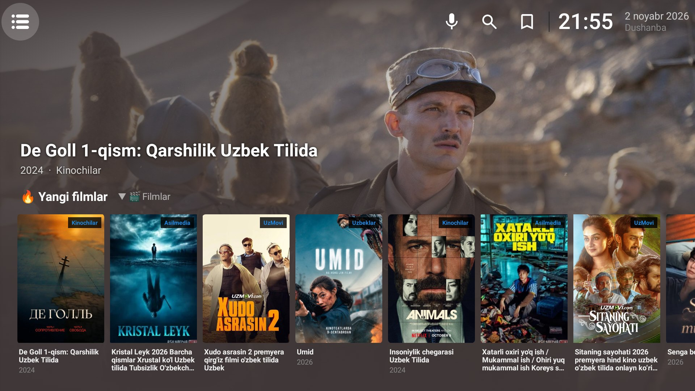
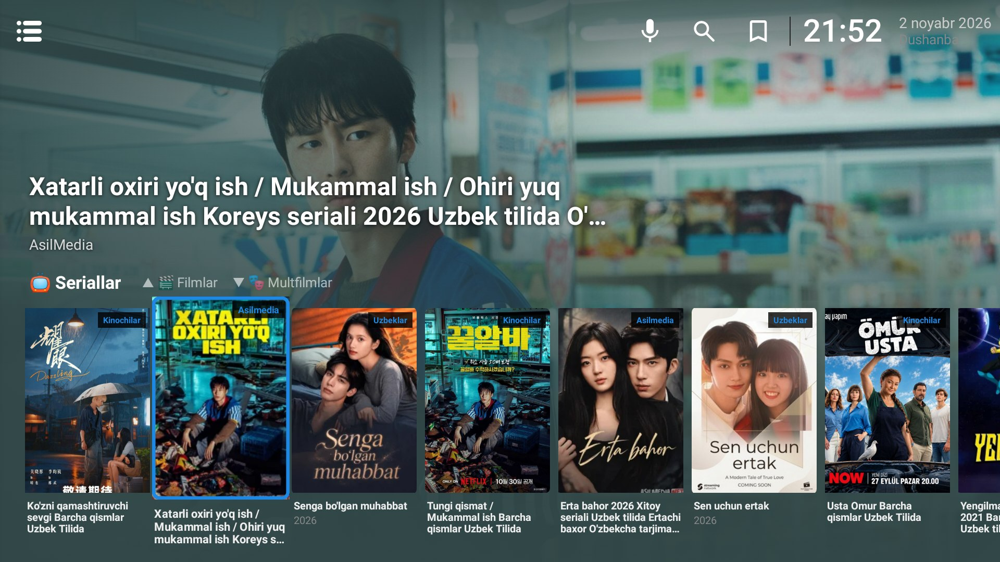
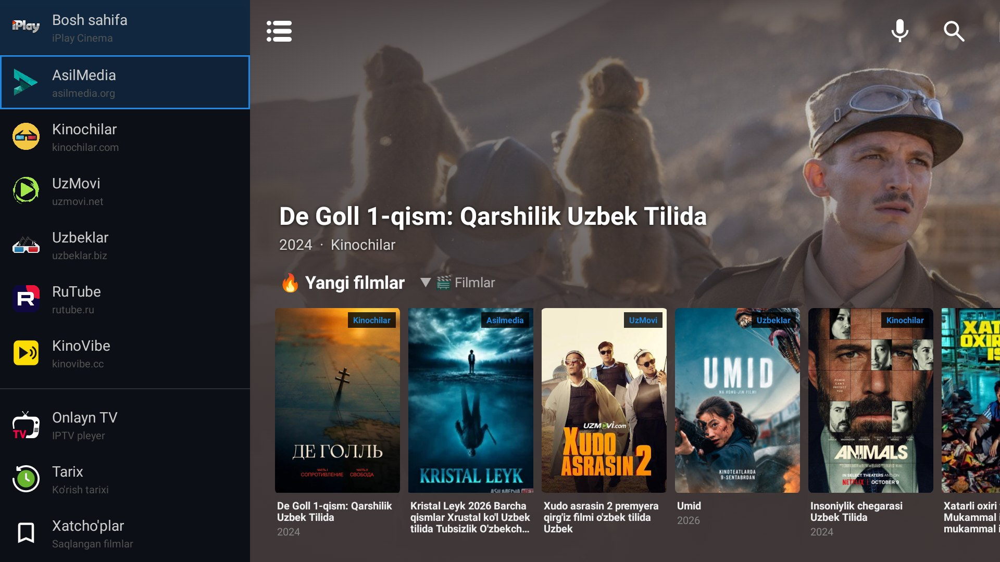
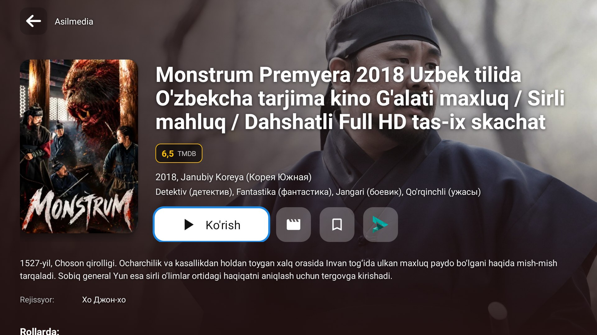
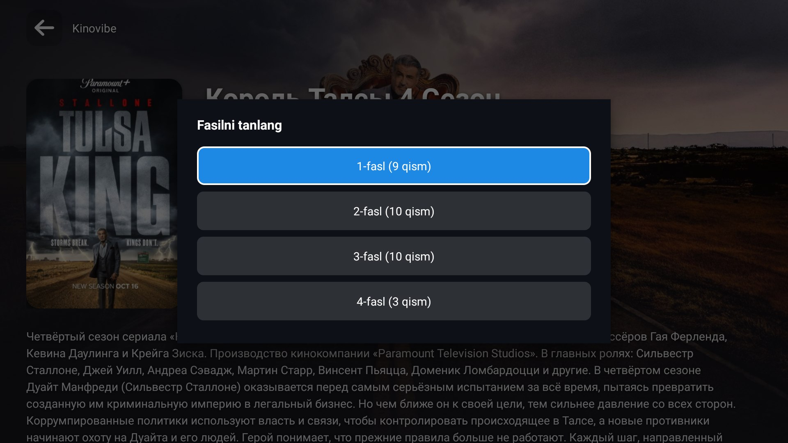
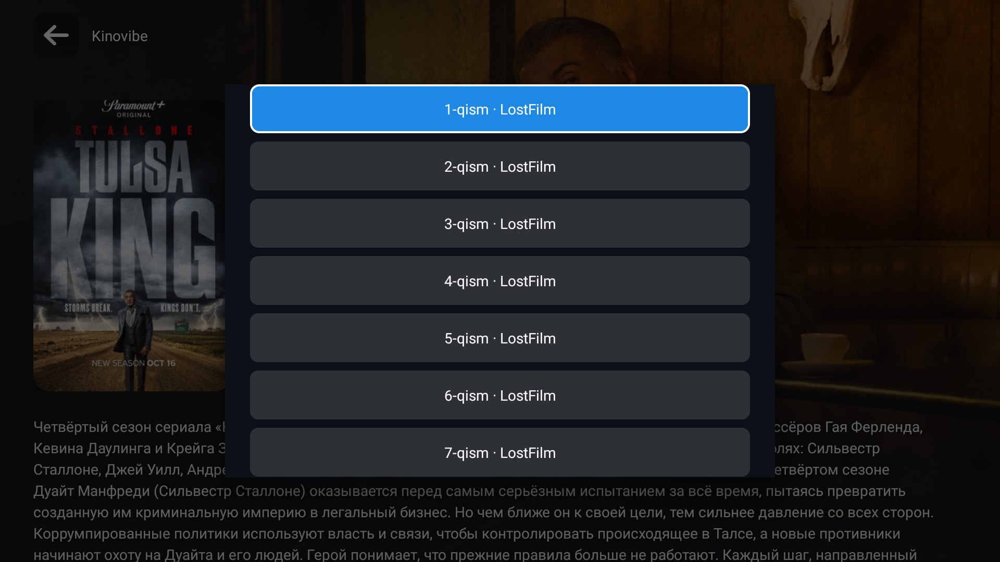
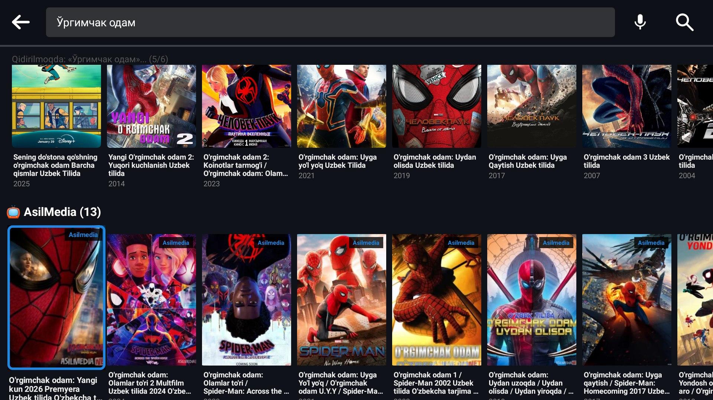
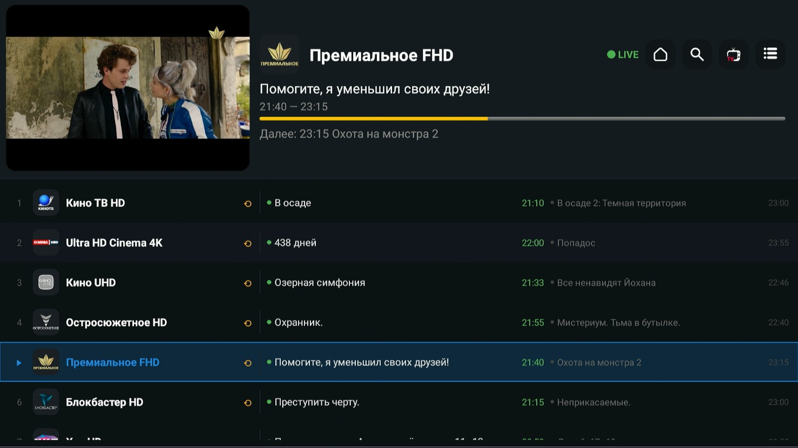

# 🎬 iPlay Cinema

**Фильмы, сериалы и ТВ-каналы на узбекском и русском — в одном приложении для Android TV**

Android TV · Fire TV · Google TV · телефоны и планшеты на Android

---

## ✨ Что умеет

### 🏠 Главная
Большие обои фильма в фокусе и один ряд карточек. Стрелками ↑/↓ переключаются подборки: новинки, фильмы, сериалы, мультфильмы, Top 100, боевики, комедии, фантастика, ужасы, турецкие сериалы, узбекское кино, фильмы на русском. Каждая подборка собрана с нескольких сайтов сразу — если один сайт не работает, ряд всё равно полный. У конца ряда фильмы догружаются сами.

  
  

### 🌐 Шесть источников
| Сайт | Что там |
|---|---|
| **AsilMedia** | фильмы и сериалы на узбекском |
| **Kinochilar** | переводные фильмы, сериалы, мультфильмы, Top 100 |
| **UzMovi** | фильмы и сериалы на узбекском |
| **Uzbeklar** | переводы, узбекское кино, сериалы |
| **KinoVibe** | фильмы, сериалы, аниме, дорамы на русском |
| **RuTube** | видео и фильмы с RuTube |

У каждого сайта — свои разделы и жанры, всё листается пультом.

### 🎞️ Карточка фильма
Обои и рейтинг из TMDB, год, страна, жанры, описание, режиссёр и актёры. Кнопки: смотреть, трейлер, в закладки. Если сайт показывает видео в нескольких качествах — можно выбрать.

  

### 📺 Сериалы: сезоны и серии
Сначала выбирается сезон, потом серия. «Назад» возвращает к сезонам. Рядом с серией видно озвучку. В плеере — кнопка «Следующая серия».

  
  

### 🔍 Поиск по всем сайтам сразу
Один запрос — результаты со всех источников, по рядам. Можно писать кириллицей («Ўргимчак одам») — поиск сам переведёт в латиницу и попробует разные написания (k/q, g/gʻ, x/h).

  

### 🎙️ Голосовой поиск
Держите кнопку микрофона на пульте и скажите название. Узбекский язык распознаётся **прямо на устройстве**, без Google и без интернета. Для русского — Google или модель на устройстве. Модели (~50 МБ) скачиваются в настройках.

Фильмы iPlay Cinema также появляются в общем поиске Android TV.

### 📡 Онлайн ТВ (IPTV)
Свой плейлист M3U и телепрограмма (EPG):
- список каналов с текущей и следующей передачей
- телепрограмма на несколько дней: вчера, сегодня, завтра
- **архив** — смотреть прошедшие передачи, с начала передачи, перемотка
- переключение каналов и передач прямо в полноэкранном режиме, выбор звуковой дорожки
- программа хранится компактно (~70 МБ) и обновляется сама

  

### 📌 И ещё
- **Закладки** и **история просмотров**
- **Ряд iPlay Cinema на главном экране Android TV** — новинки выбранных сайтов
- **Встроенный плеер** (ExoPlayer) или любой внешний плеер на выбор
- **Три языка интерфейса:** oʻzbekcha, русский, English
- **Цвет интерфейса** на выбор
- **Свой ключ TMDB** — по желанию
- **Обновления** — приложение само проверяет новую версию на GitHub и показывает историю изменений
- Работает и на **телефоне**: касания, свайпы, вертикальный экран

---

## 📥 Установка

1. Откройте [последний релиз](https://github.com/azimoff7007/iplay-cinema-releases/releases/latest) и скачайте файл `iPlay_Cinema_v….apk`
2. **Android TV / Google TV:** установите через файловый менеджер (например X-plore) или Downloader
3. **Fire TV:** приложение *Downloader* → вставьте ссылку на APK → установить. В настройках разрешите установку из неизвестных источников
4. **Телефон:** откройте APK и разрешите установку

Новые версии можно ставить поверх старой — закладки и история сохраняются.

---

## ⚠️ Важно

Приложение бесплатное. Оно не хранит и не раздаёт видео — только показывает то, что открыто публикуют сами сайты. Предназначено для личного использования.

---

👤 **Автор:** Ali Azimov

